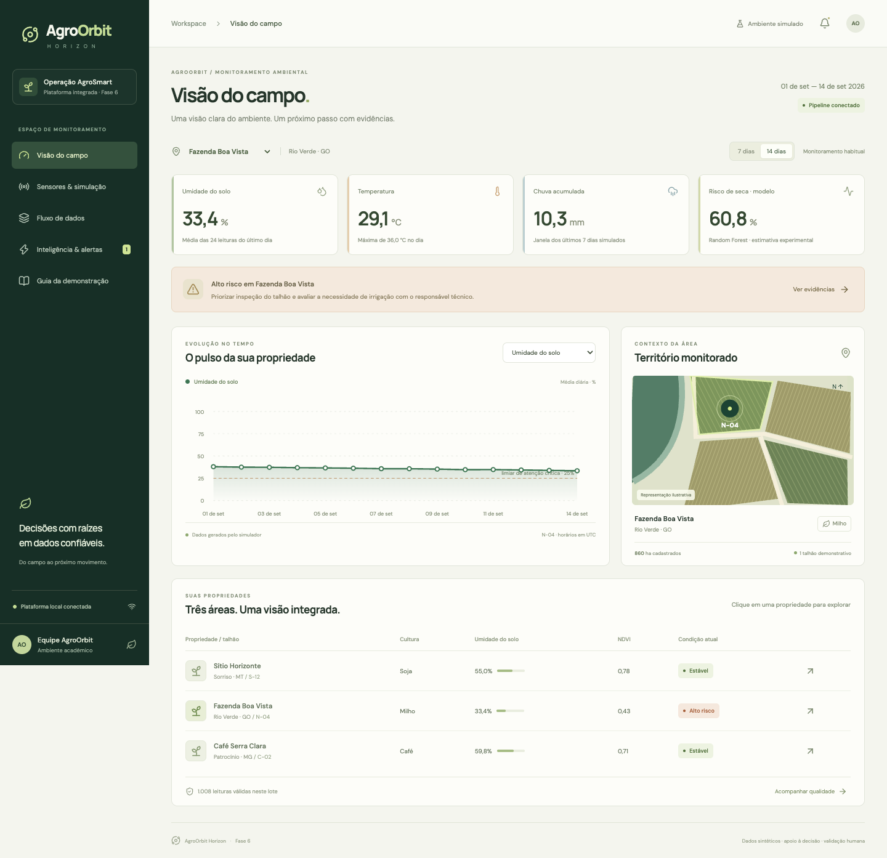

# AgroOrbit Horizon · Fase 6

**Do campo ao próximo movimento.** Plataforma integrada do PBL AgroSmart: sensores virtuais → preparação de dados → análise de risco → alertas → dashboard.



A entrega transforma a arquitetura e o protótipo da Fase 5 em um fluxo executável. Os indicadores são calculados pelo backend, e cada cenário recalcula as leituras, as features, a probabilidade do modelo e as decisões exibidas. Todos os dados ambientais desta fase são **sintéticos**; não há conexão ativa com satélites, hardware ou serviços de previsão do tempo.

## Executar

Pré-requisitos: **Python 3.9+** e **Node.js 22.12+**. Testado com Python 3.9.6 e Node 24.21.0.

```bash
npm ci --ignore-scripts
npm run build
npm start
```

Abra **http://127.0.0.1:8766**. O backend Python não requer instalação de pacotes: o modelo já está exportado em um formato portátil. Use `Ctrl+C` para encerrar.

No ZIP de entrega, `dist/` já acompanha o pacote: basta executar `python3 -m backend.server`. No Windows, use `py -m backend.server` se `python3` não existir.

### Demonstração sugerida

1. Selecione **Fazenda Boa Vista** e observe os indicadores.
2. Abra **Sensores & simulação**, escolha **Estresse hídrico**, semente `42`, e execute.
3. Confira **Inteligência & alertas**: regras acionadas, probabilidade e evidências do lote.
4. Execute **Recuperação após chuva** e compare os indicadores.
5. Execute **Falha de sensor**: o último dia fica indisponível e a decisão atual é suspensa.
6. Em **Fluxo de dados**, confira a quarentena e baixe os datasets do lote atual.

Cada execução reconstrói 14 dias simulados. Os cenários alteram apenas a propriedade selecionada; as demais mantêm exatamente as mesmas leituras. As execuções ficam em `data/runs/`, ignorado pelo Git. Reiniciar o servidor restaura o cenário habitual; não há um serviço de coleta em tempo real.

## Artefatos por requisito

| Requisito | Evidência entregue |
| --- | --- |
| 1. Arquitetura integrada | [Diagrama SVG](docs/arquitetura.svg) e [componentes](docs/01-arquitetura.md) |
| 2. Coleta/simulação | [Simulador](backend/simulator.py), [sensores](docs/02-sensores.md) e [captura](docs/evidencias/02-simulador.png) |
| 3. Processamento | [Pipeline](backend/pipeline.py), [dataset Silver](data/sample/silver.csv), [Gold](data/sample/gold.csv) e [fluxo](docs/03-processamento.md) |
| 4. Automação inteligente | [Modelo](backend/model.py), [regras](backend/rules.py), [alertas](data/sample/alerts.json) e [decisões](docs/04-automacao.md) |
| 5. Dashboard analítico | [Interface React](src/main.jsx), [indicadores](docs/05-dashboard.md) e [capturas](docs/evidencias/) |
| 6. Demonstração de 3–5 min | [Vídeo completo, 3min43s (MP4)](https://raw.githubusercontent.com/agroorbit-org/agroorbit-fase6/main/output/video/agroorbit-fase6-demo.mp4), [roteiro](docs/06-roteiro-video.md) e [conferência](docs/07-entrega.md) |
| Relatório consolidado | [Relatório PDF](output/pdf/agroorbit-fase6-relatorio.pdf) |

O vídeo contém captura real da aplicação e narração neural em português brasileiro, sintetizada localmente com Kokoro. O roteiro foi adaptado para apresentação conversada, com intervalos curtos entre os blocos. O MP4 também acompanha o ZIP, em `output/video/agroorbit-fase6-demo.mp4`. A voz é sintética, não uma gravação de integrante.

O arquivo `entrega.json` guarda a identificação e as pendências administrativas. A versão de preparação pode ser gerada mesmo com campos pendentes; o empacotador final bloqueia dados de equipe ou link de vídeo ausentes.

## Reproduzir dados e testes

```bash
# Regenera a amostra habitual versionada e o snapshot estático.
npm run data

# Testes de integração dos dados, decisões, modelo e HTTP.
npm test

# Cenário reproduzível em pasta própria.
python3 -m backend.pipeline --scenario seca --target faz-002 --seed 42 --output data/runs/exemplo-seca

# Reprocessa o mesmo Bronze sem simular novamente.
python3 -m backend.pipeline --input data/sample/bronze.jsonl --output data/runs/replay
```

`checksums.json` permite conferir que a reexecução do mesmo lote gera os mesmos resultados. O horário adotado em todo o conjunto é **UTC**. A janela demonstrativa é fixa: **01–14/09/2026**.

Para desenvolver a interface: deixe `npm start` em um terminal e `npm run dev` em outro. O Vite encaminha `/api` para o backend. Abrir apenas a versão estática disponibiliza o snapshot versionado em modo **somente leitura**, explicitamente indicado na interface.

## Continuidade das fases

| Projeto anterior | Reaproveitamento e limite |
| --- | --- |
| [agroorbit-fase5](https://github.com/agroorbit-org/agroorbit-fase5) | Marca Horizon, três propriedades demonstrativas e organização Bronze/Silver/Gold. O console foi evoluído para consumir os resultados do pipeline. |
| [agroorbit-ai](https://github.com/agroorbit-org/agroorbit-ai) | Random Forest treinado, categorias, escalonamento e 14 features. Exportação das 300 árvores em JSON comprimido; comparação de 500 entradas com o modelo original. |
| [agroorbit-vision](https://github.com/agroorbit-org/agroorbit-vision) | Componente orbital de referência para a continuidade. A CNN **não é executada nem contabilizada como integração ativa** nesta fase. |

Proveniência exata em [docs/08-proveniencia.md](docs/08-proveniencia.md). Não é preciso baixar os outros repositórios para executar esta entrega.

## Modelo e limites

- O modelo e seus rótulos de treinamento são sintéticos. A saída é uma estimativa experimental, sem validação agronômica de campo.
- Inferência é liberada somente após 14 dias completos do talhão. Uma falha no último dia suspende a condição atual; valores antigos não substituem leituras atuais.
- As explicações desta interface são regras explícitas, **não SHAP**. O projeto anterior conserva o módulo SHAP original.
- Limiares didáticos não são uma prescrição de irrigação. O sistema gera alertas e recomendações para avaliação humana; não atua sobre equipamentos reais.
- Sem credenciais, dados pessoais de produtores, MQTT real, envio de WhatsApp ou dependência de cloud.

Para reexportar o modelo, use um ambiente Python 3.10–3.12 isolado, instale `requirements-model.txt` e execute `scripts/export_model.py --source CAMINHO/best_model.pkl`. Isso é opcional para desenvolvimento; não é necessário para a demonstração.

## Estrutura

```text
backend/          simulador, validação, features, modelo, regras e servidor HTTP
src/              dashboard React responsivo
models/           árvores exportadas e relatório de paridade
data/sample/      Bronze, Silver, Gold, alertas, quarentena e checksums
public/data/      snapshot para visualização estática
tests/            testes automatizados e casos de referência do modelo
docs/             relatório em Markdown, arquitetura e capturas
scripts/          exportação, validação visual e empacotamento
output/pdf/       relatório consolidado
output/video/     vídeo de demonstração
entrega.json      identificação da equipe e informações de submissão
```
