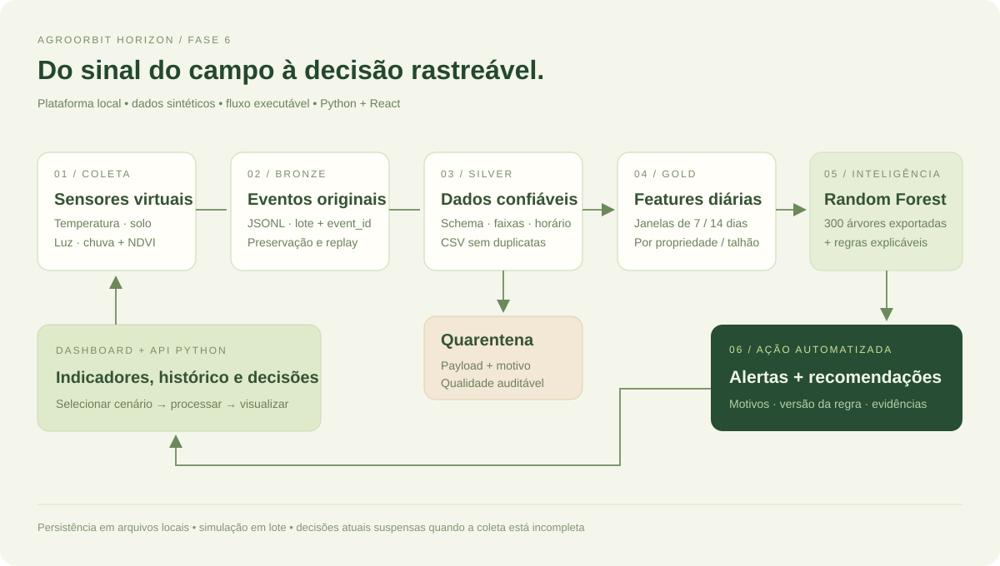
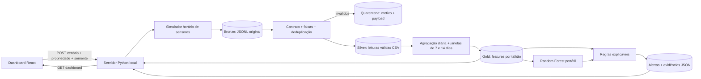

# 1. Arquitetura da solução

O AgroOrbit Horizon consolida os componentes de dados da Fase 5 e o modelo do AgroOrbit AI em uma plataforma local. A operação completa acontece no computador do avaliador, sem contas em serviços externos.

| Componente | Responsabilidade | Implementação |
| --- | --- | --- |
| Sensores virtuais | Gerar temperatura, umidade do solo, luz e precipitação; contexto orbital sintético | `backend/simulator.py` |
| Bronze | Preservar a entrada e permitir replay | `bronze.jsonl` por lote |
| Validação | Verificar contrato, domínio, horário e faixas; detectar retransmissão e conflitos | `backend/pipeline.py:validate` |
| Silver | Organizar leituras válidas, ordenadas por propriedade e horário | `silver.csv` |
| Gold | Calcular médias, extremos, chuva acumulada e tendência de NDVI | `backend/pipeline.py:aggregate` |
| Inferência | Aplicar o Random Forest anterior com os mesmos pré-processadores | `backend/model.py` + `models/risk_forest.json.gz` |
| Automação | Classificar a situação e registrar recomendação com regras e linhagem | `backend/rules.py` |
| API local | Executar o lote, disponibilizar snapshot consistente e downloads | `backend/server.py` |
| Dashboard | Explorar propriedades, evolução, sensores, qualidade e alertas | `src/main.jsx` |

O contrato `telemetry.v2` evolui a organização proposta na Fase 5. Acrescenta unidades explícitas, marcação `simulated`, sensores e validação executável. A transição Bronze/Silver/Gold é uma implementação local em arquivos, não um Data Lake distribuído. Airflow, armazenamento cloud, autenticação multiusuário, fontes externas e WhatsApp são evoluções futuras.

O servidor usa um lock para publicar em conjunto snapshot e arquivos do lote. O mesmo lote tem identificador determinístico, e uma reexecução substitui somente seus próprios resultados reproduzíveis. O servidor escuta apenas `127.0.0.1`; a entrega é um protótipo acadêmico local.
